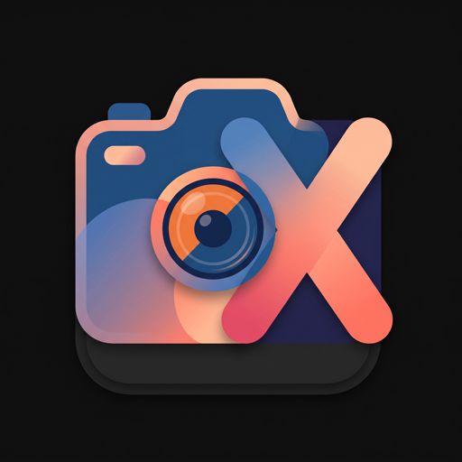

# GXVcam

<p align="center">
  
</p>

Camera app for **Android 14+ / Android 16 (SDK 36)** targeting the **Motorola Edge 50 Neo** (Dimensity 7300, tested on Android 16)
and **Edge 60 Neo** (Dimensity 7400, Android 15/16):

* **GCam-style interface**: own implementation in Jetpack Compose (no Google code/assets).
* **Burst RAW fusion** based on published HDR+ / multi-frame super-resolution research.
* **vivo-like rendering** (Natural / Vivid looks, restrained highlights, natural skin),
  achieved by our own calibration against reference photos (no vivo code/data).
* **MediaTek-aware capture**: correct RAW10/RAW16 handling, per-frame dynamic black level,
  Camera2 Extensions and any vendor tags the HAL actually exposes.

See [`docs/LEGAL_AND_SOURCES.md`](docs/LEGAL_AND_SOURCES.md) for the limits on reusing GCam/vivo.

## Download & Releases

Pre-built APKs are available under GitHub Releases:
* [**Download latest GXVcam APK (v0.3.0)**](https://github.com/Antux912012/GXVcam/releases/download/v0.3.0/GXVcam-v0.3.0.apk)

## Features & Status

| Area | State | Highlights |
| :--- | :--- | :--- |
| **PIP Video & Dual Capture** | ✅ Complete MotCamera5 Dual-View Parity | Simultaneous front (32MP Samsung S5KJD1) and rear (50MP Sony IMX896) camera concurrent recording; **Draggable Picture-in-Picture (PIP)** floating window with rounded corners and drop shadow; **50:50 Split-Screen** mode with central divider; **Instant Camera Swap (`⇄`)** flipping primary and secondary feeds on the fly; Dispatched Motorola OEM HAL vendor tags (`is_dual_capture`, `pipzoomratio`, and `com.mediatek.streamingfeature.pipDevices`) |
| **Motorola Camera 5 Video Suite** | ✅ Complete Edge 50 Neo OEM Parity | **4K UHD** (3840×2160), **1080p FHD**, and **720p HD** resolution selector; **30fps**, **60fps**, and **120fps Slow-Mo**; Motorola Video Stabilization (**Adaptive OIS+EIS** via `vstab_smarteis_enable`, **360° Horizon Lock** via `vstab_ihc_enable`, Off); **Video Night Vision** (`VideoNVwithoutVstab`); **HDR10+ 10-bit HLG** (`hdr10_mode_tuning`, `3d_hdr_mode`); and **Directional Audio Zoom** tracking lens zoom ratio |
| **Gravity Sensor & Photo Orientation** | ✅ Google Photos Aligned | Dynamic gravity-sensor orientation listener mapping device tilt to `targetRotation` with physical bitmap rotation (90° portrait / horizontal landscape) and normalized EXIF orientation (`ORIENTATION_NORMAL = 1`), guaranteeing photos shot horizontally appear horizontal in Google Photos and galleries with zero rotation errors |
| **Multi-Camera & Aux Sensors** | ✅ Verified on Edge 50 Neo | Bypasses `vendor.camera.aux.packagelist` to expose & bind Camera 0 (Main 50MP Sony IMX896), Camera 2 (13MP GalaxyCore GC13A2 Ultra-Wide 0.6x), Camera 3 (10MP Samsung S5K3K1 Telephoto 3x), and Camera 5 (Logical multi-camera) |
| **Focus & Exposure (AE/AF Split Lock)** | ✅ Sony Alpha Separate AE & AF | Dedicated top-bar buttons for **AE** and **AF** reflecting active Sony Alpha shooting modes (`AF-C`, `AF-S`, `AF-Auto`, `AF-L`, `AF-M` / `AE-Multi`, `AE-Center`, `AE-Spot`, `AE-L`, `AE-M`); independent `[AE-L]` and `[AF-L]` viewfinder pills to lock/unlock exposure or focus separately |
| **Tactile LRA Ratchet Feedback** | ✅ Niagara-Style Haptic Engine | Hardware Linear Resonant Actuator (LRA) ratchet vibration (`VibrationEffect.EFFECT_TICK`) across all sliders: Niagara expandable EV bar, Pro manual sliders (EV, ISO, Kelvin, Focus), JPEG quality compression slider, LibPatcher tuning sliders, and continuous zoom ruler |
| **Sony Alpha Composition Grids** | ✅ 6 Precision Guides | Rule of 3rds (3×3), Square Grid (4×4), Diag. + Square (Sony Alpha signature diagonal guides), Golden Ratio (Phi), Center Crosshair, and Off |
| **Calibrated Gyro Horizon Level** | ✅ MotCamera5 Algorithmic Calibration | Extracted from Motorola Camera 5 (`MultiSensorOrientationEventListener` & `LevelerComponent`) with planar desk detection and 10-sample rolling average smoothing |
| **Aspect Ratios** | ✅ 5 Cinematic & Photo Ratios | 4:3, 16:9, 1:1 square, 3:2 classical 35mm, and 21:9 ultra-wide cinematic framing with M3 rounded corner viewfinders |
| **Color Space & Imaging** | ✅ Professional Gamuts | sRGB, DCI-P3 Wide Gamut, and Adobe RGB with embedded ColorSpace metadata; Adjustable JPEG compression quality slider (50%–100%, default 85%) |
| **Capture Formats** | ✅ 3-Way Mode | JPEG only, 16-bit uncompressed RAW (.dng) only, and simultaneous RAW + JPEG capture |
| **M3 Expressive PRO Mode** | ✅ Complete & De-cluttered | Live parameter readout, instant AUTO reset per parameter & global RESET ALL, quick-stop chips (ISO 100–6400, Shutter 1/4000s–32s, White Balance modes + Kelvin slider, AF-C / Macro / Infinity); configurable sidebar (Left/Right) or strip (Top/Bottom) |
| **Color Profile (LUT Engine)** | ✅ Top-Bar Dropdown | Moved from viewfinder carousel to top-left dropdown (Zeiss Natural, Leica Authentic/Vibrant, Vivo Vivid, GCam HDR+, Pantone, and LibPatcher) |
| **MotCamera5 & GCam Settings** | ✅ Implemented | 50MP Quad-Bayer remosaic, ADRC dynamic range, Tintless lens shading, ZSL, Super Night, Anti-banding, Burst HDR+ frame count, Gyro Horizon level, RGB Histogram |
| **Theming & Accents** | ✅ Pantone & Material 3 | Motorola Edge 50 Neo Pantone editions (Poinciana, Nautical Blue, Lattè, Grisaille), Leica Amber, Expressive Mint, and Material You dynamic wallpaper |
| **Vulkan & RAW Pipeline** | ✅ Implemented | 16-bit RAW_SENSOR unpacker with Vulkan compute shader and CPU reference |

## Layout

```
GXVcam/
├── app/src/main/cpp/          native engine (C++20 + Vulkan)
│   ├── include/               raw_pipeline.hpp, vivo_engine.hpp (stage interfaces)
│   ├── src/raw_unpacker.cpp   CPU reference unpack/normalize
│   ├── shaders/               unpack_raw10.comp
│   └── tests/                 host unit tests
├── configs/devices/           per-device profiles (expectations; runtime values come from HAL)
├── docs/                      ARCHITECTURE, MEDIATEK_OPTIMIZATION, IMAGING_PIPELINE, LEGAL_AND_SOURCES
└── tools/                     mtk_camera_probe.py, testdata/
```

## Run what exists today

```bash
# Native unit test (host, no phone needed)
cd app/src/main/cpp/tests
g++ -std=c++20 -Wall -Wextra -I../include ../src/raw_unpacker.cpp test_raw_unpacker.cpp -o /tmp/gxv_test && /tmp/gxv_test

# Probe a connected phone (USB debugging on, RSA prompt accepted)
python3 tools/mtk_camera_probe.py -o probe_out/edge50neo
# ...or parse a saved dump
python3 tools/mtk_camera_probe.py --from-file tools/testdata/dumpsys_sample.txt -o /tmp/probe
```

## Dev environment (to install, see build plan Phase 0)

JDK 17, Android SDK (platform 35, build-tools 35), NDK r27+, CMake 3.22+, Android Studio
(or cmdline-tools + Gradle wrapper), `glslc` (ships with the NDK) for shaders.
