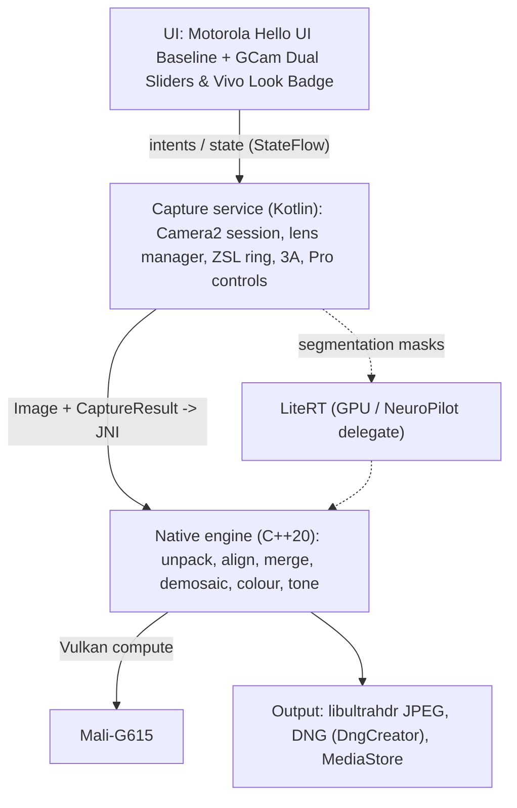

# GXVcam: architecture

## 1. Layers

### UI Design Language: Motorola Hello UI + GCam & Vivo Integrations
* **Baseline Aesthetics**: Clean Motorola "Hello UI" (MotCamera5) design with standard top quick bar, horizontal mode carousel (`Slow Mo`, `Video`, `Photo`, `Portrait`, `Pro`, `Night Vision`, `Ultra-Res 50M`), concentric dual-ring shutter button, and floating zoom buttons (`.5`, `1x`, `2x`, `3x`, `6x`).
* **GCam Enhancements**:
  * Tap-to-focus Dual Exposure Sliders (Highlight EV + Shadow tone recovery).
  * Google AWB toggle badge in viewfinder.
  * Artificial Horizon Leveler with tilt degree indicator.
* **Vivo Enhancements**:
  * AI Color Look Badge in top bar (toggling *Zeiss Natural*, *Vivo Vivid*, *Moto Natural*, *Leica Mono*).
  * Anti-blooming highlight sigmoid roll-off.
  * Frequency-separation skin engine.
* **Motorola Hardware Extensions**:
  * **Ultra-Res 50M Mode**: Direct MediaTek Quad-Bayer hardware remosaicing (`com.lenovo.moto.quadra_cfa.do_remosaic = 1`).
  * **Pro Manual Mode Bar**: Live manual adjustments for ISO (100–19200), Focus (Macro–Infinity), and Shutter Speed up to **32 seconds** (`com.lenovo.moto.sensor.info.exposureTimeRange`).

Modules (Gradle):

| Module | Content |
| :--- | :--- |
| `:app` | Activity, navigation, DI, permissions |
| `:ui` | Compose viewfinder, zoom carousel, mode switcher, sliders, settings |
| `:camera` | `CameraController`, `LensManager`, `ZslRingBuffer`, `ExtensionsBridge`, `DeviceProfile` |
| `:engine` | JNI + `app/src/main/cpp` (moves here once Gradle is set up) |
| `:tools` (host) | probe, calibration scripts, host unit tests |

## 2. Capture flow

1. **Session:** preview `SurfaceView` (PRIVATE) + `ImageReader` RAW (`RAW_SENSOR`, else `RAW10`)
   + optional YUV for analysis. Check the combination with
   `CameraDevice.isSessionConfigurationSupported()` (API 31+) before opening, since MTK HALs
   reject some RAW+preview size combos.
2. **ZSL ring:** repeating request writes RAW into a ring of N `Image`s
   (`maxImages = N + 2`); oldest is closed when full. Each image is paired with its
   `TotalCaptureResult` by `SENSOR_TIMESTAMP`.
3. **Shutter:** take the last K frames (ZSL, zero lag) **or**, for night/HDR, issue a burst
   with custom exposure (`captureBurst`) after the press.
4. **Hand-off:** copy plane data + metadata to native (`ByteBuffer` direct → JNI), close the
   `Image` immediately so the HAL never stalls.
5. **Processing:** in a foreground-safe background worker; viewfinder stays live.
   Show a thumbnail from the reference frame immediately (GCam behaviour).
6. **Fallback:** if a lens has no RAW, or the HAL advertises Camera2 Extensions for the mode,
   use those (YUV/JPEG path), so every lens/mode always works.

## 3. Threads

| Thread | Priority | Responsibility |
| :--- | :--- | :--- |
| Main | default UI | Compose, gestures |
| `CameraHandler` (HandlerThread) | `THREAD_PRIORITY_DISPLAY` | Camera2 callbacks, requests |
| `ImageReader` handler | `THREAD_PRIORITY_DISPLAY` | Drain RAW, ring bookkeeping |
| Native processing pool (2–3 threads, big cores) | `THREAD_PRIORITY_BACKGROUND` + boost while user waits | Pipeline orchestration, CPU stages |
| Vulkan queue | n/a | GPU stages, one command buffer per stage |

(There's no `THREAD_PRIORITY_CAMERA` constant in Android; the earlier doc was wrong.)

## 4. Memory & buffers
* One CPU→GPU copy per frame is the baseline; AHardwareBuffer import is an optimisation
  (see MTK doc §5).
* Streaming merge into one float accumulator; peak native memory budget ~600 MB.
* Handle `onTrimMemory` and thermal status (`PowerManager.getCurrentThermalStatus`) by
  reducing burst size.

## 5. Output
* JPEG: **Ultra HDR** (gain map) via libultrahdr, Display P3; plain SDR JPEG option.
* DNG: `DngCreator` from the reference frame (or merged Bayer written as DNG, Phase 5+).
* Saved through `MediaStore` (scoped storage), EXIF + orientation.

## 6. Verification hooks
* Host unit tests for every CPU stage (`app/src/main/cpp/tests`).
* GPU stages are checked against the CPU reference (max abs error < 1e-4) on device.
* "Golden burst" regression set: bursts captured on the Edge 50 Neo saved as raw +
  metadata, re-processed on every change, diffed by PSNR/ΔE.
