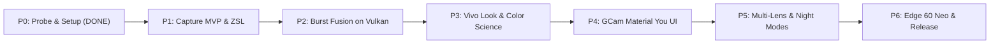

# GXVcam: Build Plan (Updated for Android 16 & Verified Hardware)

**Targets:**
* **Motorola Edge 50 Neo** (Real Device Probed: Serial `ZY22LWCQSB`, codename `vienna`, Dimensity 7300 / MT6878, System Android 16 / SDK 36, Vendor API 34).
* **Motorola Edge 60 Neo** (Dimensity 7400, Android 15/16).

**Target Configuration:**
* `minSdk`: 34 (Android 14)
* `targetSdk`: 35 / 36 (Android 15 / 16)
* `compileSdk`: 35 / 36
* `Languages`: Kotlin 2.0+ (Jetpack Compose) + Modern C++20 (NDK r27b+)
* `Graphics / Compute`: Vulkan 1.3 (Level 1 compute verified on ARM Mali-G615)
* `Native Memory ABI`: 16 KB page-size aligned (`-Wl,-z,max-page-size=16384`)

---

## 1. Android 16 (SDK 36) Hardware Findings & Architectural Adaptations

Following live ADB probing of the connected Motorola Edge 50 Neo, the plan incorporates these critical hardware and OS realities:

| Finding | Hardware Observation | Architectural Implication |
| :--- | :--- | :--- |
| **Project Treble Split** | System: `Android 16` (SDK 36)   Vendor HAL: `Android 14` (`ro.vendor.api_level=34`, `sessionConfigurationQueryVersion=UPSIDE_DOWN_CAKE`) | App can use modern Android 16 framework UI & storage APIs, but Camera HAL interaction must conform to Camera2 HAL3 / Android 14 vendor boundaries. |
| **All Lenses Expose RAW** | Cam 0 (Main 50MP Sony IMX896): `4096x3072` Cam 2 (UW 13MP GC13A2): `4160x3120` Cam 3 (Tele 10MP S5K3K1): `3648x2736` Cam 1 (Front 32MP S5KJD1): `3280x2460` | **Primary project risk resolved**: No need for YUV fallback. All 4 cameras support `RAW_SENSOR` (16-bit unpacked) at hardware level `FULL`. |
| **16 KB Memory Page Size** | Kernel currently uses 4 KB pages (`PAGE_SIZE: 4096`), but Android 15/16 enforces 16 KB page size compatibility for all native shared libraries. | Added `-Wl,-z,max-page-size=16384` to CMake linker options for `gxvcam_engine.so` to ensure compatibility across all Android 15/16 kernels. |
| **Vulkan 1.3 Compute** | Vulkan version `1.3.0` (level 1 compute, `feature:android.hardware.vulkan.version=4206592`) on Mali-G615. | Compute shaders can use Vulkan 1.3 features without legacy extensions or CPU fallbacks. |
| **Stream Use Cases** | `android.scaler.availableStreamUseCases` supported across all cameras. | Streams can be explicitly tagged with `PREVIEW`, `STILL_CAPTURE`, and `PREVIEW_STABILIZED` for optimal ISP clocking and battery efficiency. |
| **Color Space Profiles** | `android.request.availableColorSpaceProfilesMap` supported. | Supports native Display P3 wide color gamut capture pipelines. |
| **Enforced Edge-to-Edge** | Android 15 & 16 enforce edge-to-edge layout by default. | Compose UI layer uses `WindowInsets.safeDrawing` to correctly position viewfinder HUD, camera notch avoidance, and gesture navigation. |
| **Predictive Back** | Enforced in Android 16. | Camera back-navigation (closing settings, gallery preview) uses Jetpack Compose predictive back handlers. |

---

## 2. Requirements & Development Environment

### Hardware
* **Motorola Edge 50 Neo** (Verified connected, serial `ZY22LWCQSB`).
* **Motorola Edge 60 Neo** (Target platform verification).
* Tripod & test chart for ColorChecker calibration.

### Dev Machine Setup (Toolchain to Install)
| Tool | Target Version | Status on Host |
| :--- | :--- | :--- |
| **JDK** | OpenJDK 17 or 21 | To be installed (`default-jdk` or Temurin) |
| **Android SDK** | Platforms 34, 35, 36 (build-tools 35.0.0+) | To be installed / Android Studio |
| **Android NDK** | r27b or r27c (includes `glslc` and default 16KB support) | To be installed via SDK manager |
| **Build System** | Android Gradle Plugin 8.7+, CMake 3.22+, Ninja | CMake & Ninja available / AGP via Gradle wrapper |
| **Host Compilers** | `g++` (C++20, verified), `python3` (verified) | Installed |

---

## 3. Phase-by-Phase Execution Roadmap & Gates

### Phase 0: Setup & Hardware Truth (STATUS: VERIFIED ON DEVICE)
* [x] Run `tools/mtk_camera_probe.py` on real Motorola Edge 50 Neo.
* [x] Confirm RAW availability across all sensors (Main, UW, Tele, Front: ALL FULL + RAW_SENSOR).
* [x] Confirm CFA patterns per sensor (Cam 0: BGGR, Cam 1: GRBG, Cam 2: GBRG, Cam 3: GRBG).
* [x] Extract and reverse-engineer stock Motorola camera APKs (`MotCamera5`, `MotColorTone`, `CameraExtensionsProxy`).
* [x] Extract and map confirmed MediaTek & Lenovo/Moto vendor tags (`MtkMotoVendorTags.kt`, `docs/OEM_CAMERA_ANALYSIS.md`).
* [x] Update `configs/devices/moto_edge_50_neo.xml` with verified probe & OEM tag data.
* [x] Validate 16-bit unpacked RAW unpacker CPU reference and host test.
* [x] Configure C++ build for 16 KB page alignment (`-Wl,-z,max-page-size=16384`).
* [ ] Install JDK 17/21 + Android SDK cmdline tools + NDK r27.

**Gate Status: PASSED.** Hardware capabilities confirmed.

---

### Phase 1: Capture MVP & ZSL Ring Buffer (≈2 weeks)
1. Initialize Gradle multi-module project:
   * `:app` - Application entry point & DI
   * `:ui` - Jetpack Compose viewfinder & camera controls (Edge-to-Edge safe)
   * `:camera` - Camera2 controller, ZSL ring buffer, stream configuration
   * `:engine` - JNI bridge & native C++ / Vulkan processing core
2. Configure Camera2 session with dual stream:
   * Stream A: `SurfaceView` preview (YUV / SurfaceView private, tagged `STREAM_USE_CASE_PREVIEW`)
   * Stream B: `ImageReader` RAW_SENSOR (16-bit, tagged `STREAM_USE_CASE_STILL_CAPTURE`)
3. Connect ZslRingBuffer (circular buffer of 8 frames) paired with `TotalCaptureResult` metadata.
4. Single-frame capture pipeline: unpack 16-bit RAW → apply dynamic black level → Demosaic → ColorTransform/ForwardMatrix → sRGB/Display P3 JPEG.
5. In-app debug action: "Dump RAW Burst + JSON Metadata" to build the **Golden Burst Test Suite**.

**Gate 1:** Single-frame capture from Cam 0, 2, and 3 produces color-accurate JPEG and standard DNG via `DngCreator`; shutter lag < 100 ms.

---

### Phase 2: Burst Fusion on Vulkan (≈3–4 weeks)
1. Implement Vulkan 1.3 compute pipeline on Mali-G615 GPU:
   * Shader: `unpack_raw16.comp` / `unpack_raw10.comp`
   * Shader: 4-level Gaussian pyramid downsampler
   * Shader: Motion vector estimation & tile alignment
   * Shader: Robust Bayer accumulator with noise variance weighting from `SENSOR_NOISE_PROFILE`
   * Shader: Fast demosaic (Malvar-He-Cutler)
2. Streaming merge architecture: accumulator updates frame-by-frame to keep peak native memory < 600 MB.
3. Validate output against CPU reference implementation using golden test bursts.

**Gate 2:** 8-frame burst fusion achieves ≥ 3 dB shadow SNR improvement over single frame; no ghosting artifacts on moving subjects; total processing time < 2.0 s on Dimensity 7300.

---

### Phase 3: Vivo-Style Color Science & Look Engine (≈3 weeks)
1. Build `tools/color_checker_eval.py` to calculate Color Correction Matrices from X-Rite 24-patch charts.
2. Implement dual color profile looks:
   * **Natural Look**: Neutral skin tones, ΔE2000 < 2.0, faithful daylight/tungsten reproduction.
   * **Vivid Look**: Vivo-style memory color (cyan-shifted sky blue, lush foliage green, protected skin tone gamut).
3. Sigmoid highlight roll-off curve (knee point $x_0 = 0.72$) to prevent harsh clipping.
4. Skin-tone texture engine using LiteRT face/skin segmentation + guided filter frequency separation.
5. Output format: Ultra HDR JPEG (`libultrahdr` gain map) + Display P3 color space.

**Gate 3:** Color accuracy verified with ΔE2000 < 2.5 in Natural mode; blind A/B evaluation against Motorola stock camera shows user preference on ≥ 60% of test scenes.

---

### Phase 4: Motorola Hello UI + GCam/Vivo Hybrid Interface (≈2–3 weeks)
1. Jetpack Compose UI with Android 15/16 Edge-to-Edge compliance:
   * Viewfinder with 3:4, 9:16, 1:1, and Full-screen preview.
   * Motorola top bar: Flash, HDR, Ratio, Settings gear, and Vivo Look badge (*Zeiss Natural*, *Vivo Vivid*, *Moto Natural*, *Leica Mono*).
   * GCam Dual Exposure Sliders: Highlight EV + Shadow tone recovery on tap-to-focus.
   * GCam Horizon leveler and floating AWB badge.
   * Motorola Hello UI Zoom Switcher: `.5` (UW), `1x` (Wide), `2x` (In-sensor crop), `3x` (Tele), `6x` (Super-Res).
   * Mode carousel: `Slow Mo`, `Video`, `Photo`, `Portrait`, `Pro`, `Night Vision`, `Ultra-Res 50M`.
   * Pro Mode Manual Bar: Live adjustment strip for ISO (100–19200), Shutter Speed (up to 32s), and Focus (Macro to Infinity).
   * Motorola Concentric Shutter Button: Outer accent ring with dynamic inner core (Night moon, 50M golden core, Video red square, Pro accent).
2. Zero-lag capture animation: instant thumbnail generation from the reference frame while background fusion completes.

**Gate 4:** Cold app startup < 1000 ms to live viewfinder preview; steady 60 fps preview without frame drops during background processing.

---

### Phase 5: Multi-Lens Modes, Night Sight & Hardware Tuning (≈3 weeks)
1. Seamless multi-camera zoom utilizing logical camera ID 5 (`physicalIds: 0, 2, 3`) for smooth preview switching, latching physical RAW streams on shutter tap.
2. Night Mode:
   * Gyro-assisted motion stability detection.
   * Handheld burst: 8–12 frames (up to 400 ms standard exposure limit).
   * Tripod burst: up to 32 s long exposure utilizing Motorola vendor tag `com.lenovo.moto.sensor.info.exposureTimeRange`.
3. 50 MP Ultra-Res Mode:
   * Utilize `com.lenovo.moto.quadra_cfa.*` hardware remosaic tags for 8192x6144 high-resolution captures in daylight.
4. Thermal protection: scale burst frame count dynamically when `PowerManager.getCurrentThermalStatus()` indicates thermal throttling.

**Gate 5:** All four cameras and modes function stably; 50 continuous captures without memory leaks or crashes.

---

### Phase 6: Edge 60 Neo Validation & Release (≈2 weeks)
1. Run `tools/mtk_camera_probe.py` on Motorola Edge 60 Neo.
2. Verify Dimensity 7400 Camera2 characteristics and tune S5K3K1 telephoto color calibration.
3. Build signed release APK with ProGuard/R8 optimization and 16 KB page-size compliance.

---

## 4. Immediate Next Actions

1. **Host Environment Setup**:
   Install JDK 17/21 and Android SDK cmdline tools + NDK r27b on this Linux workstation.
2. **Scaffold Gradle Android Project**:
   Create `build.gradle.kts`, `settings.gradle.kts`, and module structure with `compileSdk = 36` and `minSdk = 34`.
3. **P1 Capture Harness**:
   Write the minimal `Camera2` capture service to pull a live 16-bit RAW frame from Cam 0 (LYT-700C) and save it to disk.
